# DeVIZ / HubNear

[English](README.md) · [Русский](README.ru.md)

**DeVIZ** is a mobile-first service for spontaneous meetups around activities near you.
Find a company for sports, walks, and group activities in a couple of clicks.

<p align="center">
  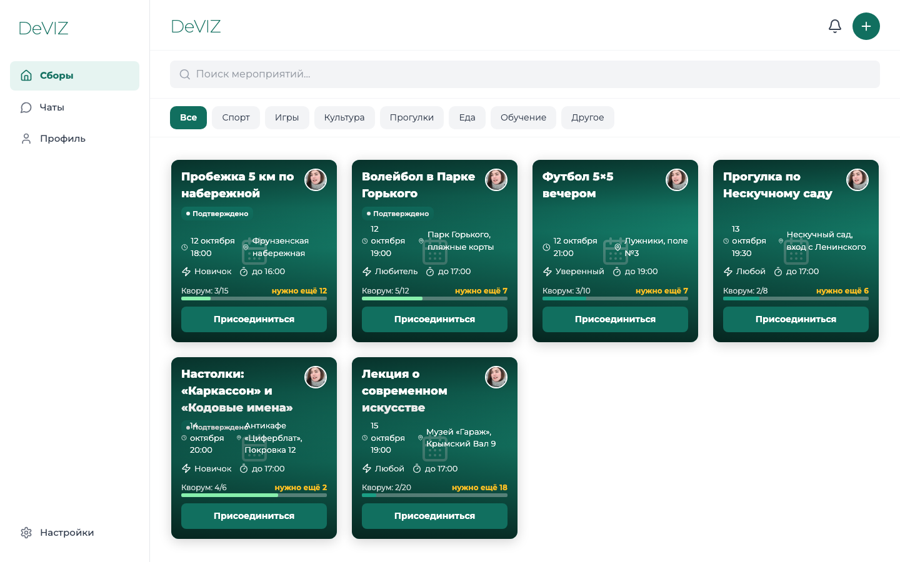
</p>

## Problem

> “I want to play volleyball tonight, but I have no one to play with.”
> “People gather in the park to play football — how do I join them?”

In big cities people increasingly want to stay active, but they cannot find a company.
Existing solutions are either too formal (clubs and sections) or give no guarantee
that the event will actually happen.

## Solution

DeVIZ is a **marketplace of spontaneous activities** with a quorum mechanic:

- A user creates a meetup (e.g. “Volleyball at Gorky Park at 19:00, need 12 people”)
- Other users see the meetup on the map / in the feed and join
- If the minimum number of participants is reached by the deadline, the meetup is
  **confirmed** and everyone gets a notification
- All participants are automatically added to the event chat

## Value

- **For participants**: find activities nearby without a club subscription
- **For organizers**: no waiting in vain if the quorum is not collected
- **For business**: a venue to promote sports events and locations

## Screenshots

<table>
  <tr>
    <td align="center">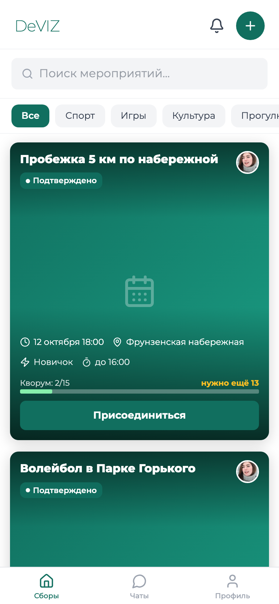<br><sub>Activity feed with quorum</sub></td>
    <td align="center">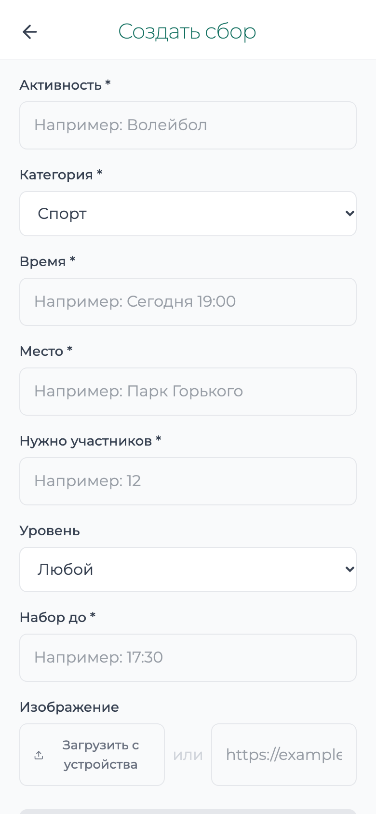<br><sub>Create a meetup</sub></td>
    <td align="center">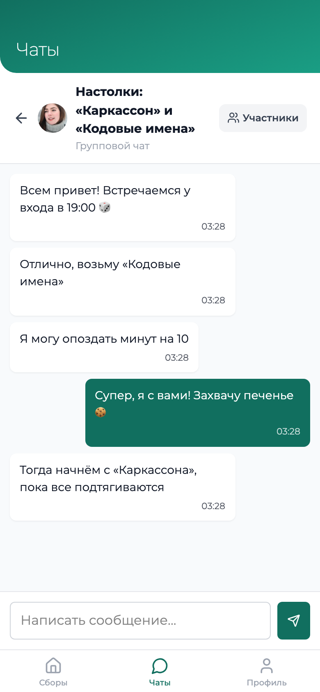<br><sub>Event chat (WebSocket)</sub></td>
    <td align="center">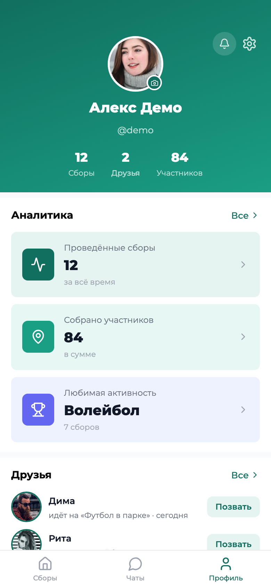<br><sub>Profile</sub></td>
  </tr>
  <tr>
    <td align="center">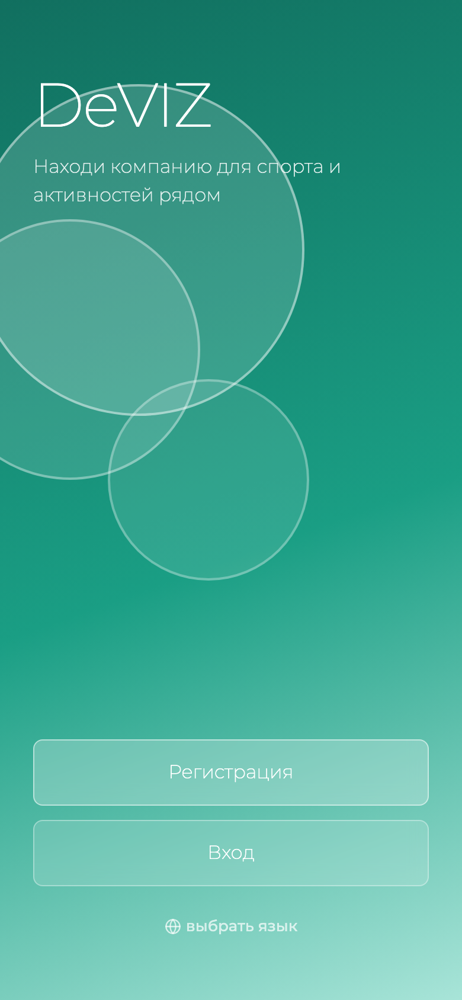<br><sub>Welcome</sub></td>
    <td align="center">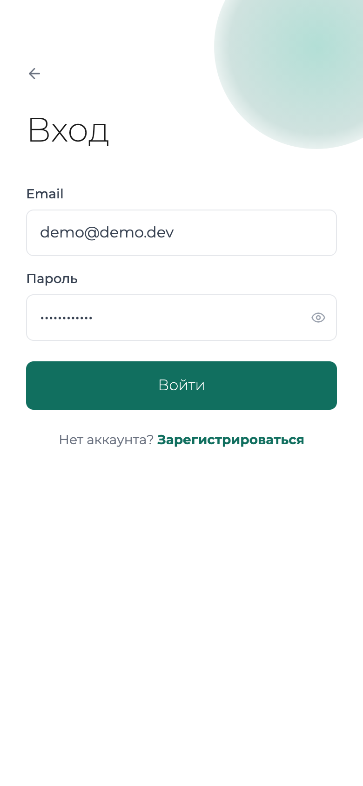<br><sub>Sign in</sub></td>
    <td align="center">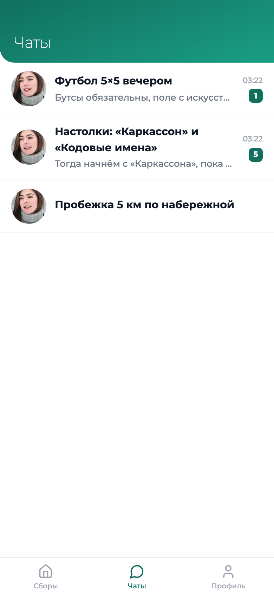<br><sub>Chats</sub></td>
    <td></td>
  </tr>
</table>

Screenshots are taken from the local dev build with demo data (mobile viewport 390×844, desktop 1440×900).

## Architecture

### System overview

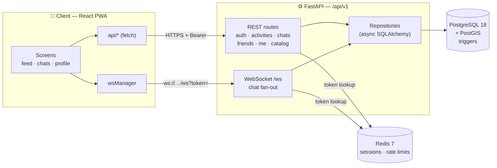

```
docker-compose.yml           # API + PostGIS + Redis
Makefile                     # dev / build / test / lint shortcuts

backend/                     # Python 3.14 + FastAPI
  ├── app/
  │   ├── main.py            # App factory: CORS, security headers, routes
  │   ├── db.py              # Async SQLAlchemy engine
  │   ├── redis.py           # Redis sessions + rate limiter
  │   ├── core/config.py     # Env-based config (DATABASE_URL / REDIS_URL)
  │   └── api/
  │       ├── errors.py      # APIError + exception handler
  │       └── v1/
  │           ├── routes/    # auth, activities, chats, friends, cities, catalog, me/, ws
  │           ├── repositories/  # SQL queries (activity_repo.py, user_repo.py)
  │           ├── schemas.py     # Pydantic models
  │           ├── dependencies.py# Bearer token → user_id
  │           └── pagination.py  # Cursor-based pagination
  ├── migrations/            # Alembic (3 migrations)
  └── tests/                 # API smoke tests (pytest + httpx)

frontend/                    # React 18 + TypeScript + Vite 6 + PWA
  └── src/app/
      ├── api/               # API client (11 modules: auth, activities, chats, ws, …)
      ├── hooks/             # State hooks (useHubData, useEvents, useChats, …)
      ├── components/        # Reusable components + Radix-based UI kit
      ├── screens/           # 15 screens
      └── constants/         # Styles
```

### Key decisions

| Decision | Why |
|----------|-----|
| **FastAPI + async SQLAlchemy** | Async PostgreSQL under the hood — scales with load |
| **PostGIS** | Geo queries: radius, proximity, city boundaries |
| **PostgreSQL triggers** | Quorum, statuses, auto-chat, notifications — at the DB level, no race conditions |
| **Redis sessions** | Token-based auth with sliding expiration + rate limiter |
| **Bearer token** | Instead of the insecure `X-User-Id` header |
| **Repository pattern** | SQL lives outside route files — cleaner and easier to test |
| **Cursor pagination** | Stable feed paging (`items` + `next_cursor`) even while data is inserted |
| **WebSocket chat** | Real-time messages: `subscribe` / `message` / `ping` protocol |
| **PWA** | Installable app: manifest, standalone display, mobile meta tags |

## Tech stack

| Component | Technology |
|-----------|------------|
| Backend | Python 3.14, FastAPI, SQLAlchemy (async), psycopg 3, PostgreSQL 18 + PostGIS 3.6, Redis 7 |
| Frontend | React 18, TypeScript, Vite 6, Tailwind CSS 4, Radix UI, MUI icons, lucide-react |
| Realtime | WebSockets (FastAPI), in-memory chat fan-out |
| PWA | `public/manifest.json`, standalone meta tags, `vite-plugin-pwa` in dependencies |
| Infra | Docker Compose, Alembic, uv, npm |

## Quick start

### Prerequisites

- Docker & Docker Compose
- Node.js 20+
- Python 3.14+ (optional, for running tests/migrations outside Docker)

### 1. Configure environment

```bash
cp .env.example .env
```

Defaults are fine for Docker. Note: PostgreSQL is published on host port **5433**
(`5433:5432`), so if you run migrations from the host, set `POSTGRES_PORT=5433` in `.env`.

### 2. Start the database and apply migrations

```bash
docker compose up -d db redis

# Inside the api container (uses in-network db:5432):
docker compose build api && docker compose run --rm api alembic upgrade head

# Or from the host (requires POSTGRES_PORT=5433 in .env):
make migrate
```

### 3. Start the backend

```bash
docker compose up --build
```

API: `http://localhost:8000` · Swagger UI: `http://localhost:8000/docs` · Health: `http://localhost:8000/health`

Published ports: API `8000`, PostgreSQL `5433`, Redis `6379`.

### 4. Start the frontend

```bash
cd frontend && npm install && npm run dev
```

App: `http://localhost:5173`.

> **Note on the API origin.** The client calls the API on the **same origin** at
> `/api/v1` (`frontend/src/app/api/client.ts`), and the WebSocket connects to
> `ws(s)://<host>/api/v1/ws?token=…`. There is no dev proxy in `vite.config.ts`,
> so for local development either add one:
>
> ```ts
> // vite.config.ts
> server: {
>   proxy: {
>     "/api": { target: "http://localhost:8000", ws: true },
>   },
> }
> ```
>
> or serve the built frontend and the API behind a single origin (nginx, Caddy, tunnel).

### 5. Smoke tests

```bash
# Requires a running PostgreSQL + Redis (and .env)
make test
# Or: cd backend && uv run pytest tests/ -v
```

## Configuration

All configuration is environment-driven (`backend/app/core/config.py`).

| Variable | Default | Description |
|----------|---------|-------------|
| `POSTGRES_DB` | `dvizh` | Database name |
| `POSTGRES_USER` | `dvizh` | Database user |
| `POSTGRES_PASSWORD` | `dvizh` | Database password |
| `POSTGRES_HOST` | `localhost` | Database host (`db` inside Compose) |
| `POSTGRES_PORT` | `5432` | Database port (`5433` from the host with Compose) |
| `DATABASE_URL` | — | Full SQLAlchemy URL; overrides `POSTGRES_*` |
| `REDIS_HOST` | `localhost` | Redis host (`redis` inside Compose) |
| `REDIS_PORT` | `6379` | Redis port |
| `REDIS_DB` | `0` | Redis database index |
| `REDIS_URL` | — | Full Redis URL; overrides `REDIS_*` |
| `API_PORT` | `8000` | Host port for the API |

## API

Base path: `/api/v1` · Interactive docs: `http://localhost:8000/docs`

### System
- `GET /` — service name
- `GET /health` — health check (`{"status": "ok"}`)

### Auth
- `POST /api/v1/auth/register` — registration (email, password, name, optional `city_id`, `timezone`); returns a generic message to avoid email enumeration
- `POST /api/v1/auth/login` — login, returns `token` + user profile
- `POST /api/v1/auth/logout` — logout (204)
- `POST /api/v1/auth/logout-all` — logout on all devices (204)
- `GET /api/v1/auth/verify` — validate the token, return the profile
- `GET /api/v1/auth/me` — current user profile
- `POST /api/v1/auth/password-change` — change password

### Activities
- `GET /api/v1/activities` — feed with cursor pagination; filters: `city_id`, `category`, `status`, `search`, `lat`+`lon`+`radius_m`, `limit` (≤50), `cursor`
- `POST /api/v1/activities` — create a meetup
- `GET /api/v1/activities/{id}` — details
- `PATCH /api/v1/activities/{id}` — update
- `GET /api/v1/activities/{id}/participants` — participant list
- `POST /api/v1/activities/{id}/join` — join
- `POST /api/v1/activities/{id}/leave` — leave
- `POST /api/v1/activities/{id}/cancel` — cancel

### Chats
- `GET /api/v1/chats` — list chats
- `POST /api/v1/chats` — create a chat
- `GET /api/v1/chats/{id}` — chat details
- `GET /api/v1/chats/{id}/messages` — messages
- `POST /api/v1/chats/{id}/messages` — send a message
- `DELETE /api/v1/chats/{id}/members/{uid}` — remove a member

### Friends
- `GET /api/v1/friends` — friend list
- `POST /api/v1/friends/{user_id}` — send a friend request
- `DELETE /api/v1/friends/{user_id}` — remove a friend
- `GET /api/v1/friends/requests` — incoming/outgoing requests
- `POST /api/v1/friends/requests/{user_id}` — send a request
- `POST /api/v1/friends/requests/{user_id}/accept` — accept
- `POST /api/v1/friends/requests/{user_id}/reject` — reject

### Me (current user)
- `GET /api/v1/me/` · `PATCH /api/v1/me/` — profile
- `GET /api/v1/me/activities` — my activities (cursor pagination)
- `GET /api/v1/me/notifications` — notifications
- `POST /api/v1/me/notifications/{id}/read` — mark as read
- `POST /api/v1/me/notifications/read-all` — mark all as read
- `GET /api/v1/me/devices` · `POST /api/v1/me/devices` · `DELETE /api/v1/me/devices/{id}` — push tokens
- `GET /api/v1/me/places` · `POST /api/v1/me/places` · `DELETE /api/v1/me/places/{id}` — favorite places

### Catalog & cities
- `GET /api/v1/cities` · `GET /api/v1/cities/{id}` — cities
- `GET /api/v1/catalog/activity-categories` — activity categories
- `GET /api/v1/catalog/activity-levels` — skill levels

### WebSocket

`ws(s)://<host>/api/v1/ws?token=<session token>`

Client → server:

| Message | Payload |
|---------|---------|
| `subscribe` | `{"type": "subscribe", "chat_id": "…"}` |
| `unsubscribe` | `{"type": "unsubscribe", "chat_id": "…"}` |
| `message` | `{"type": "message", "chat_id": "…", "text": "…"}` |
| `ping` | `{"type": "ping"}` |

Server → client: `connected`, `subscribed`, `new_message`, `pong`, `error`.

## Database logic (PostgreSQL triggers)

Quorum and social side-effects are enforced in the database, so concurrent
requests cannot race past the business rules:

- `activity_participants_before_insert` — blocks joining when the quorum is full
  or the activity is already closed
- `activities_after_insert` — auto-creates an event chat
- `activity_participants_after_delete` — syncs chat membership when someone leaves
- `activity_participants_add_to_chat` / `activity_participants_remove_from_chat` —
  keep chat members in sync with participants
- `activity_participants_notify_organizer` — notifies the organizer about joins/leaves

#### Meetup lifecycle

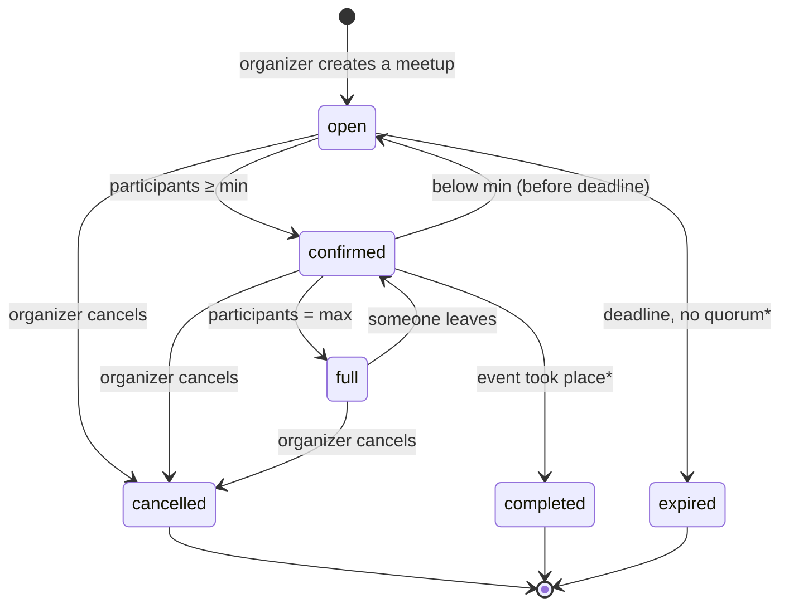

<sub>* `expired` and `completed` are part of the schema but are not set automatically yet.</sub>

#### Joining a meetup

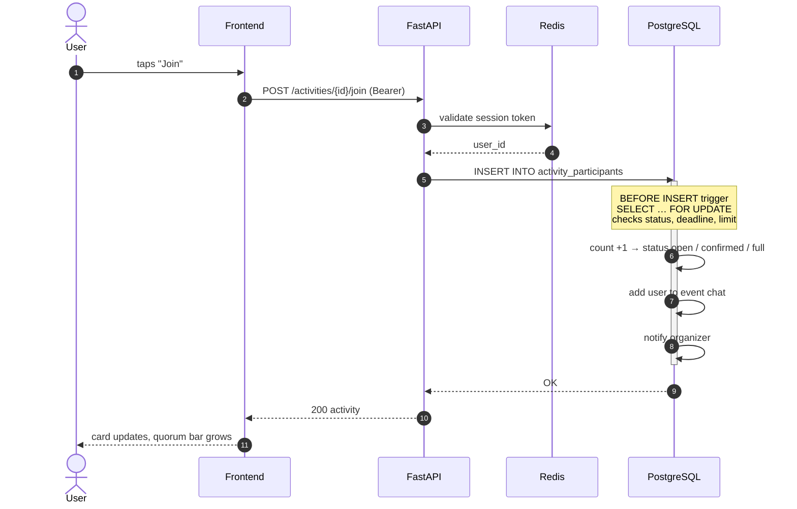

#### Data model

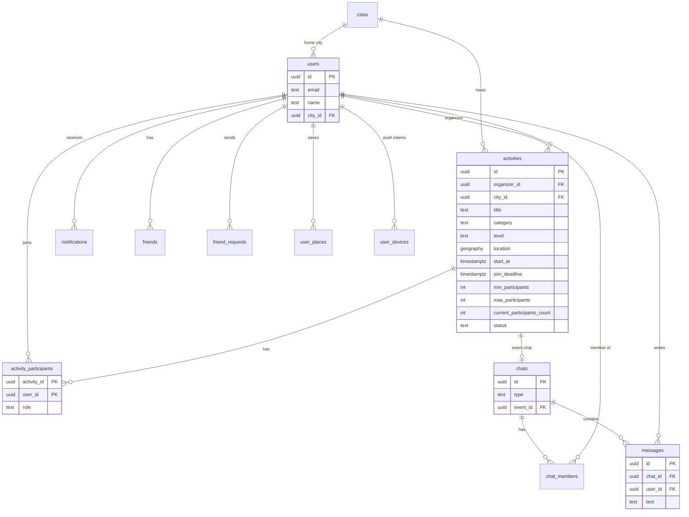

## Security

- Bearer tokens in Redis (64-byte `secrets.token_hex(32)`, 24 h TTL, sliding expiration)
- bcrypt for password hashing (`passlib` + pinned `bcrypt==4.0.1`)
- Password policy: 8–128 chars with upper + lower + digit + special character
- Rate limiting per IP (Redis): registration 10 / 20 min, login 20 / 15 min,
  password change 5 / 15 min
- Email validation (`email-validator`), normalization, and anti-enumeration responses
- CORS restricted to `localhost`, `127.0.0.1`, and `*.hubnear.app`
- Security headers: HSTS, CSP, X-Frame-Options, X-Content-Type-Options,
  X-XSS-Protection, Referrer-Policy, Permissions-Policy
- Trigger-based validation in PostgreSQL (no race conditions)
- Secrets only via environment variables
- Global exception handler that never leaks internals

## Development

### Useful commands

```bash
make dev              # docker compose up --build
make dev-background   # docker compose up --build -d
make stop             # docker compose down
make logs             # docker compose logs -f

make migrate          # alembic upgrade head
make migrate-downgrade
make migrate-reset    # downgrade base + upgrade head

make dev-backend      # uvicorn with --reload on :8000
make dev-frontend     # vite dev server
make build-frontend   # vite build
make preview          # vite preview

make test             # pytest
make test-coverage    # pytest --cov=app
make lint-backend     # ruff check
make lint-frontend    # tsc --noEmit
```

Frontend scripts (`frontend/package.json`): `npm run dev`, `npm run build`,
`npm run preview`, plus helpers `db:up` and `backend`.

### Adding a migration

```bash
cd backend
uv run alembic revision --autogenerate -m "description"
uv run alembic upgrade head
```

### Linting

```bash
make lint-backend     # ruff check
make lint-frontend    # tsc --noEmit (UI kit also has .oxlintrc.json)
```

## Contributing

1. Fork the repository.
2. Create a branch: `git checkout -b feature/your-feature`.
3. Make your changes and make sure `npm run build` and `make lint-backend` pass.
4. Open a Pull Request with a description of the changes.

## License

MIT. See [LICENSE](LICENSE).

## Roadmap

- [ ] Push notifications via FCM (`user_devices` infrastructure is ready)
- [ ] Activity map (PostGIS is ready)
- [ ] Comments and user ratings
- [ ] Calendar integration
- [ ] Onboarding and interest tags
- [ ] Group chats with polls
- [ ] Car-sharing and taxi integrations
