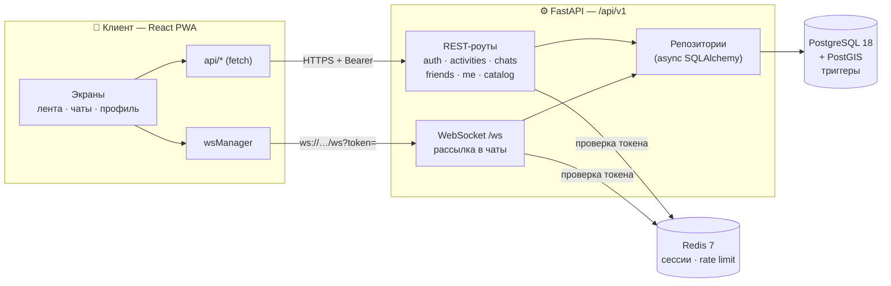
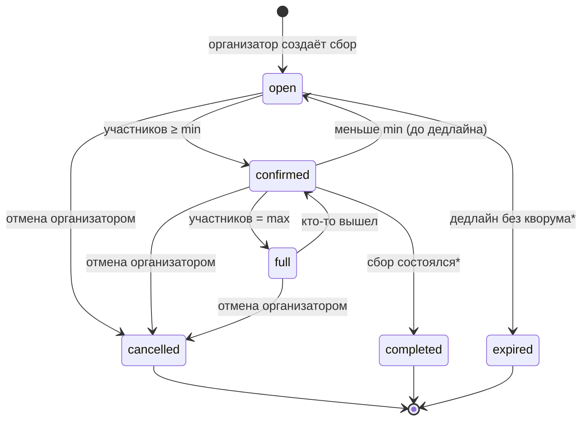
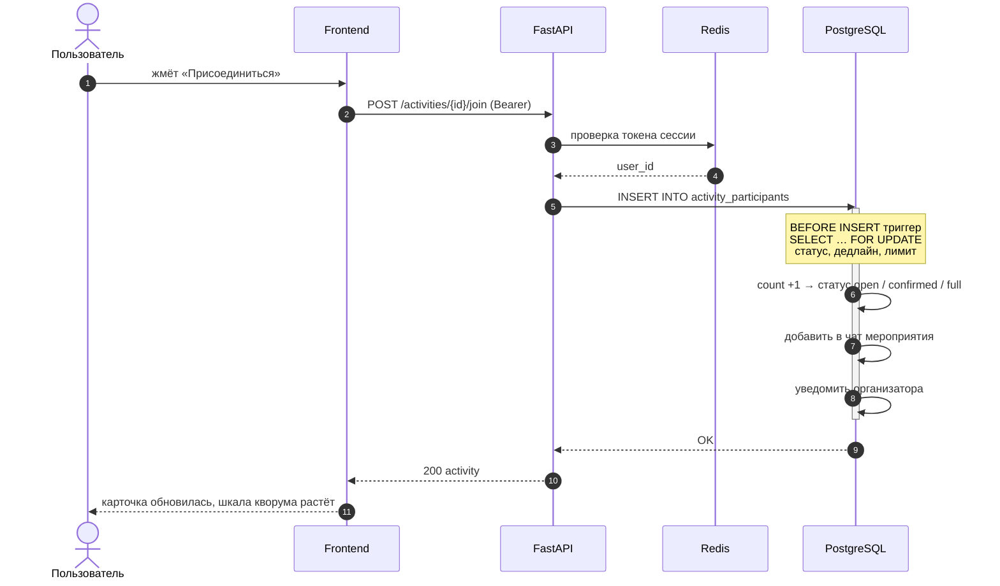
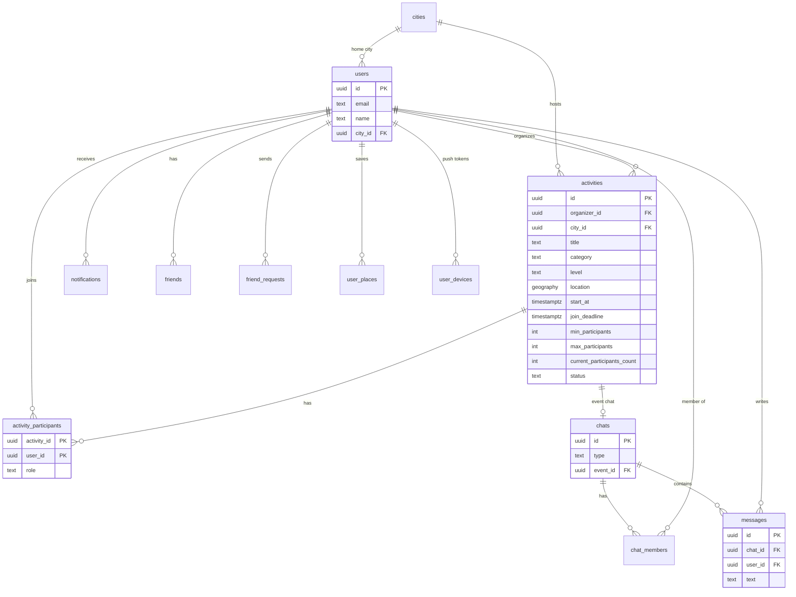

# DeVIZ / HubNear

[English](README.md) · [Русский](README.ru.md)

**DeVIZ** — мобильный сервис для быстрых сборов на активности рядом.
Находи компанию для спорта, прогулок и групповых занятий за пару кликов.

<p align="center">
  
</p>

## Проблема

> «Хочу поиграть в волейбол сегодня вечером, но не с кем».
> «В парке собираются люди поиграть в футбол — как к ним присоединиться?»

В крупных городах люди всё чаще хотят заниматься активностями, но не могут
найти компанию. Существующие решения либо слишком формальные (секции/клубы),
либо не дают гарантии, что мероприятие состоится.

## Решение

DeVIZ — это **маркетплейс спонтанных активностей** с механикой кворума:

- Пользователь создаёт сбор (например, «Волейбол в Парке Горького в 19:00, нужно 12 человек»)
- Другие пользователи видят сбор на карте/в ленте и присоединяются
- Если к дедлайну набран минимум участников — сбор **подтверждается** и уходит нотификация
- Все участники автоматически добавляются в чат мероприятия

## Ценность

- **Для участников**: находить занятия рядом без подписки на клуб
- **Для организаторов**: не ждать в пустую, если кворум не собран
- **Для бизнеса**: площадка для продвижения спортивных событий и мест

## Скриншоты

<table>
  <tr>
    <td align="center"><br><sub>Лента сборов с кворумом</sub></td>
    <td align="center"><br><sub>Создание сбора</sub></td>
    <td align="center"><br><sub>Чат мероприятия (WebSocket)</sub></td>
    <td align="center"><br><sub>Профиль</sub></td>
  </tr>
  <tr>
    <td align="center"><br><sub>Приветствие</sub></td>
    <td align="center"><br><sub>Вход</sub></td>
    <td align="center"><br><sub>Чаты</sub></td>
    <td></td>
  </tr>
</table>

Скриншоты сняты с локальной dev-сборки на демо-данных (мобильный вьюпорт 390×844, десктоп 1440×900).

## Архитектура

### Общая схема



```
docker-compose.yml           # API + PostGIS + Redis
Makefile                     # dev / build / test / lint

backend/                     # Python 3.14 + FastAPI
  ├── app/
  │   ├── main.py            # Фабрика приложения: CORS, security-заголовки, роуты
  │   ├── db.py              # Async-движок SQLAlchemy
  │   ├── redis.py           # Redis-сессии + rate limiter
  │   ├── core/config.py     # Конфигурация из окружения (DATABASE_URL / REDIS_URL)
  │   └── api/
  │       ├── errors.py      # APIError + обработчик исключений
  │       └── v1/
  │           ├── routes/    # auth, activities, chats, friends, cities, catalog, me/, ws
  │           ├── repositories/  # SQL-запросы (activity_repo.py, user_repo.py)
  │           ├── schemas.py     # Pydantic-модели
  │           ├── dependencies.py# Bearer-токен → user_id
  │           └── pagination.py  # Курсорная пагинация
  ├── migrations/            # Alembic (3 миграции)
  └── tests/                 # Smoke-тесты API (pytest + httpx)

frontend/                    # React 18 + TypeScript + Vite 6 + PWA
  └── src/app/
      ├── api/               # API-клиент (11 модулей: auth, activities, chats, ws, …)
      ├── hooks/             # Хуки состояния (useHubData, useEvents, useChats, …)
      ├── components/        # Переиспользуемые компоненты + UI-кит на Radix
      ├── screens/           # 15 экранов
      └── constants/         # Стили
```

### Ключевые решения

| Решение | Почему |
|---------|--------|
| **FastAPI + async SQLAlchemy** | Под капотом async PostgreSQL — масштабируется под нагрузку |
| **PostGIS** | Гео-запросы: радиус, близость, границы города |
| **Триггеры в PostgreSQL** | Кворум, статусы, авто-чат, нотификации — на уровне БД, без race condition |
| **Redis-сессии** | Token-based auth со sliding expiration + rate limiter |
| **Bearer-токен** | Вместо небезопасного заголовка `X-User-Id` |
| **Repository pattern** | SQL вынесен из route-файлов — чище и тестируемее |
| **Курсорная пагинация** | Стабильная лента (`items` + `next_cursor`), даже при вставке данных |
| **WebSocket-чат** | Реалтайм-сообщения: протокол `subscribe` / `message` / `ping` |
| **PWA** | Установка на экран: manifest, standalone, мобильные meta-теги |

## Стек

| Компонент | Технология |
|-----------|------------|
| Backend | Python 3.14, FastAPI, SQLAlchemy (async), psycopg 3, PostgreSQL 18 + PostGIS 3.6, Redis 7 |
| Frontend | React 18, TypeScript, Vite 6, Tailwind CSS 4, Radix UI, MUI icons, lucide-react |
| Realtime | WebSockets (FastAPI), in-memory fan-out сообщений |
| PWA | `public/manifest.json`, standalone meta-теги, `vite-plugin-pwa` в зависимостях |
| Инфра | Docker Compose, Alembic, uv, npm |

## Быстрый старт

### Предварительные требования

- Docker и Docker Compose
- Node.js 20+
- Python 3.14+ (опционально, для тестов/миграций вне Docker)

### 1. Настройте окружение

```bash
cp .env.example .env
```

Для Docker достаточно значений по умолчанию. Важно: PostgreSQL опубликован на
хосте через порт **5433** (`5433:5432`), поэтому при запуске миграций с хоста
укажите `POSTGRES_PORT=5433` в `.env`.

### 2. Запустите базу и примените миграции

```bash
docker compose up -d db redis

# Внутри контейнера api (сеть Compose, db:5432):
docker compose build api && docker compose run --rm api alembic upgrade head

# Или с хоста (нужен POSTGRES_PORT=5433 в .env):
make migrate
```

### 3. Запустите бекенд

```bash
docker compose up --build
```

API: `http://localhost:8000` · Swagger UI: `http://localhost:8000/docs` · Health: `http://localhost:8000/health`

Опубликованные порты: API `8000`, PostgreSQL `5433`, Redis `6379`.

### 4. Запустите фронтенд

```bash
cd frontend && npm install && npm run dev
```

Приложение: `http://localhost:5173`.

> **Про origin API.** Клиент ходит в API по **тому же origin** на `/api/v1`
> (`frontend/src/app/api/client.ts`), WebSocket подключается к
> `ws(s)://<host>/api/v1/ws?token=…`. Прокси в `vite.config.ts` сейчас не настроен,
> поэтому для локальной разработки добавьте его:
>
> ```ts
> // vite.config.ts
> server: {
>   proxy: {
>     "/api": { target: "http://localhost:8000", ws: true },
>   },
> }
> ```
>
> либо раздавайте собранный фронтенд и API под одним origin (nginx, Caddy, туннель).

### 5. Smoke-тесты

```bash
# Нужны запущенные PostgreSQL + Redis (и .env)
make test
# Или: cd backend && uv run pytest tests/ -v
```

## Конфигурация

Вся конфигурация — через переменные окружения (`backend/app/core/config.py`).

| Переменная | По умолчанию | Описание |
|------------|--------------|----------|
| `POSTGRES_DB` | `dvizh` | Имя базы |
| `POSTGRES_USER` | `dvizh` | Пользователь |
| `POSTGRES_PASSWORD` | `dvizh` | Пароль |
| `POSTGRES_HOST` | `localhost` | Хост базы (`db` внутри Compose) |
| `POSTGRES_PORT` | `5432` | Порт базы (`5433` с хоста в Compose) |
| `DATABASE_URL` | — | Полный URL SQLAlchemy; перекрывает `POSTGRES_*` |
| `REDIS_HOST` | `localhost` | Хост Redis (`redis` внутри Compose) |
| `REDIS_PORT` | `6379` | Порт Redis |
| `REDIS_DB` | `0` | Индекс БД Redis |
| `REDIS_URL` | — | Полный URL Redis; перекрывает `REDIS_*` |
| `API_PORT` | `8000` | Порт API на хосте |

## API

Базовый путь: `/api/v1` · Интерактивная документация: `http://localhost:8000/docs`

### Системные
- `GET /` — имя сервиса
- `GET /health` — проверка здоровья (`{"status": "ok"}`)

### Auth
- `POST /api/v1/auth/register` — регистрация (email, пароль, имя, опционально `city_id`, `timezone`); возвращает общий ответ без подтверждения существования email
- `POST /api/v1/auth/login` — вход, возвращает `token` + профиль
- `POST /api/v1/auth/logout` — выход (204)
- `POST /api/v1/auth/logout-all` — выход со всех устройств (204)
- `GET /api/v1/auth/verify` — проверка токена, возвращает профиль
- `GET /api/v1/auth/me` — профиль текущего пользователя
- `POST /api/v1/auth/password-change` — смена пароля

### Активности
- `GET /api/v1/activities` — лента с курсорной пагинацией; фильтры: `city_id`, `category`, `status`, `search`, `lat`+`lon`+`radius_m`, `limit` (≤50), `cursor`
- `POST /api/v1/activities` — создание сбора
- `GET /api/v1/activities/{id}` — детали
- `PATCH /api/v1/activities/{id}` — обновление
- `GET /api/v1/activities/{id}/participants` — список участников
- `POST /api/v1/activities/{id}/join` — присоединиться
- `POST /api/v1/activities/{id}/leave` — выйти
- `POST /api/v1/activities/{id}/cancel` — отменить

### Чаты
- `GET /api/v1/chats` — список чатов
- `POST /api/v1/chats` — создание чата
- `GET /api/v1/chats/{id}` — детали чата
- `GET /api/v1/chats/{id}/messages` — сообщения
- `POST /api/v1/chats/{id}/messages` — отправить сообщение
- `DELETE /api/v1/chats/{id}/members/{uid}` — удалить участника

### Друзья
- `GET /api/v1/friends` — список друзей
- `POST /api/v1/friends/{user_id}` — отправить запрос в друзья
- `DELETE /api/v1/friends/{user_id}` — удалить друга
- `GET /api/v1/friends/requests` — входящие/исходящие запросы
- `POST /api/v1/friends/requests/{user_id}` — отправить запрос
- `POST /api/v1/friends/requests/{user_id}/accept` — принять
- `POST /api/v1/friends/requests/{user_id}/reject` — отклонить

### Me (текущий пользователь)
- `GET /api/v1/me/` · `PATCH /api/v1/me/` — профиль
- `GET /api/v1/me/activities` — мои активности (курсорная пагинация)
- `GET /api/v1/me/notifications` — уведомления
- `POST /api/v1/me/notifications/{id}/read` — пометить прочитанным
- `POST /api/v1/me/notifications/read-all` — пометить все прочитанными
- `GET /api/v1/me/devices` · `POST /api/v1/me/devices` · `DELETE /api/v1/me/devices/{id}` — push-токены
- `GET /api/v1/me/places` · `POST /api/v1/me/places` · `DELETE /api/v1/me/places/{id}` — избранные места

### Каталог и города
- `GET /api/v1/cities` · `GET /api/v1/cities/{id}` — города
- `GET /api/v1/catalog/activity-categories` — категории активностей
- `GET /api/v1/catalog/activity-levels` — уровни подготовки

### WebSocket

`ws(s)://<host>/api/v1/ws?token=<session token>`

Клиент → сервер:

| Сообщение | Полезная нагрузка |
|-----------|-------------------|
| `subscribe` | `{"type": "subscribe", "chat_id": "…"}` |
| `unsubscribe` | `{"type": "unsubscribe", "chat_id": "…"}` |
| `message` | `{"type": "message", "chat_id": "…", "text": "…"}` |
| `ping` | `{"type": "ping"}` |

Сервер → клиент: `connected`, `subscribed`, `new_message`, `pong`, `error`.

## Логика в БД (триггеры PostgreSQL)

Кворум и социальные побочные эффекты закреплены в базе, поэтому параллельные
запросы не могут обойти бизнес-правила:

- `activity_participants_before_insert` — блокирует вход, если кворум набран
  или активность уже закрыта
- `activities_after_insert` — автоматически создаёт чат мероприятия
- `activity_participants_after_delete` — синхронизирует состав чата при выходе
- `activity_participants_add_to_chat` / `activity_participants_remove_from_chat` —
  держат участников чата в синхроне с участниками сбора
- `activity_participants_notify_organizer` — уведомляет организатора о входах/выходах

#### Жизненный цикл сбора



<sub>* статусы `expired` и `completed` есть в схеме, но пока не выставляются автоматически.</sub>

#### Как работает «Присоединиться»



#### Модель данных



## Безопасность

- Bearer-токены в Redis (64 байта `secrets.token_hex(32)`, TTL 24 ч, sliding expiration)
- bcrypt для хэширования паролей (`passlib` + пин `bcrypt==4.0.1`)
- Политика паролей: 8–128 символов, upper + lower + цифра + спецсимвол
- Rate limiter per IP (Redis): регистрация 10 / 20 мин, логин 20 / 15 мин,
  смена пароля 5 / 15 мин
- Валидация email (`email-validator`), нормализация и защита от enumeration
- CORS только для `localhost`, `127.0.0.1` и `*.hubnear.app`
- Security-заголовки: HSTS, CSP, X-Frame-Options, X-Content-Type-Options,
  X-XSS-Protection, Referrer-Policy, Permissions-Policy
- Валидация через триггеры PostgreSQL (без race condition)
- Секреты только через переменные окружения
- Глобальный обработчик исключений без утечки внутренностей

## Разработка

### Полезные команды

```bash
make dev              # docker compose up --build
make dev-background   # docker compose up --build -d
make stop             # docker compose down
make logs             # docker compose logs -f

make migrate          # alembic upgrade head
make migrate-downgrade
make migrate-reset    # downgrade base + upgrade head

make dev-backend      # uvicorn с --reload на :8000
make dev-frontend     # vite dev-сервер
make build-frontend   # vite build
make preview          # vite preview

make test             # pytest
make test-coverage    # pytest --cov=app
make lint-backend     # ruff check
make lint-frontend    # tsc --noEmit
```

Скрипты фронтенда (`frontend/package.json`): `npm run dev`, `npm run build`,
`npm run preview`, а также хелперы `db:up` и `backend`.

### Добавление миграции

```bash
cd backend
uv run alembic revision --autogenerate -m "description"
uv run alembic upgrade head
```

### Линтинг

```bash
make lint-backend     # ruff check
make lint-frontend    # tsc --noEmit (у UI-кита есть .oxlintrc.json)
```

## Участие в разработке

1. Форкните репозиторий.
2. Создайте ветку: `git checkout -b feature/your-feature`.
3. Внесите изменения и убедитесь, что проходят `npm run build` и `make lint-backend`.
4. Откройте Pull Request с описанием изменений.

## Лицензия

MIT. См. [LICENSE](LICENSE).

## План развития

- [ ] Уведомления через FCM / push (инфраструктура `user_devices` готова)
- [ ] Карта активностей (PostGIS готов)
- [ ] Комментарии и рейтинг пользователей
- [ ] Интеграция с календарём
- [ ] Онбординг и теги интересов
- [ ] Групповые чаты с голосованиями
- [ ] Интеграция с каршерингом и такси
